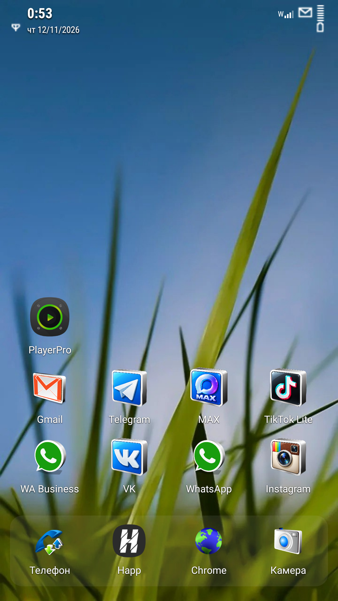

# Nokia Experience 2

> Android launcher research and development project with a separate Nokia Experience Studio desktop tool.

**🇷🇺 [Русский](#русский)** · **🇬🇧 [English](#english)**



## Русский

### Скачать

- [GitHub Release v0.1-mvp](https://github.com/dev2v07/Nokia-Expirience/releases/tag/v0.1-mvp)
- [Скачать Debug APK](https://github.com/dev2v07/Nokia-Expirience/releases/download/v0.1-mvp/Nokia-Experience-2-v0.1-mvp.apk)

Релиз содержит Debug APK. Это не подписанная production Release-сборка.

### О проекте

Nokia Experience 2 — экспериментальный Android Launcher, который объединяет собственный визуальный стиль Nokia с исследованными поведенческими решениями рабочего стола Samsung Experience. Проект включает рабочий стол, Drawer, Edit Mode, статус-бар, drag-and-drop, виджеты, темы и исследовательскую документацию.

Показанное выше изображение — реальный screenshot Nokia B из device-проверки Launcher, а не макет Studio. Он скопирован из последнего качественного pairwise device-capture в `outputs/samsung-behavioral-research/pairwise/`.

### Возможности

- Exp2 Home с несколькими рабочими столами.
- Горизонтальная навигация и единая точка settle.
- Перемещение иконок, edge-hover, Drop/Cancel и folder policy.
- App Drawer и контекстные действия.
- Edit Mode с preview рабочих столов, карточками и нижней панелью.
- Android AppWidgetHost и отдельная widget pipeline.
- Статус-бар с временем, датой, сетью, батареей и дополнительными индикаторами.
- Темы, обои и стеклянные панели Exp2.
- Исследовательские тесты workspace-engine и подробные отчёты P0–P2.5.

### Интерфейс

Основной Launcher сохраняет собственный Nokia-визуал: обои, иконки, Dock, статус-бар, панели Edit Mode и внутренние настройки. Функциональные компоненты остаются Android View/Activity-реализацией, а пользовательские данные не заменяются экспериментальными JSON-моделями.

### Nokia Experience Studio

Studio — отдельный Windows-инструмент на Python/PySide6 в [`studio/`](studio/). Он содержит Canvas телефона, дерево слоёв, инспектор свойств, Theme/Grid panels, JSON-сохранение, ADB probe, live screenshot preview, Android export, Gradle build и явную команду `APPLY TO DEVICE`.

Live Device Designer сейчас находится в разработке. Текущий live-режим использует свежие ADB screenshots; полноценное управление через scrcpy не заявляется без установленного scrcpy. Studio не выдаёт схематический Canvas за реальный Android runtime и помечает неподдержанные элементы как ограниченные/NOT EXPORTABLE.

### Поддерживаемые устройства

- Основной профиль: Samsung Galaxy A5 2017, SM-A520F.
- Целевой Android: 8.0, API 26.
- Референсное разрешение: 1080×1920.
- Рабочая density-профиль: 420 dpi override, когда он задан на Nokia B.
- Nokia B используется для проверок; Samsung A остаётся эталоном Samsung Experience и не является целью установки.

### Архитектура

- `LauncherActivity` — жизненный цикл Launcher, Home, Drawer, Edit Mode и внутренних экранов.
- `Exp2HomeDragEngine` — drag transaction, preview, edge-hover, Drop и Cancel.
- `HomeWorkspaceModel` — постоянное состояние Home и совместимость с `home_workspace`.
- `WorkspacePager`/workspace containers — навигация страниц и settle.
- `AppWidgetHost` — жизненный цикл Android-виджетов.
- `StudioRuntimeConfig` — безопасный optional bridge для экспортируемых визуальных параметров Studio.
- `studio/` — отдельная редакторская оболочка, не заменяющая функциональную модель Launcher.

### Технологии

- Java/Kotlin-compatible Android Gradle project.
- Android API 26 target profile.
- JDK 17 и Gradle 9.5 в проверенной конфигурации.
- Python 3.11+ и PySide6 для Studio.
- ADB для read-only probe, screenshots, установки и Apply.
- JSON для управляемой визуальной конфигурации Studio.
- Android VectorDrawable/drawable resources для статус-бара.

### Установка и сборка

Проект не хранит `local.properties`, Gradle caches и сгенерированные APK. Для сборки используйте Android Studio или установленный Gradle/JDK 17:

```powershell
$env:JAVA_HOME = "<путь к JDK 17>"
$env:GRADLE_USER_HOME = "<путь к Gradle cache>"
gradle :app:testDebugUnitTest :app:assembleDebug
```

Для Studio:

```powershell
python -m pip install -r studio/requirements.txt
$env:NOKIA_ANDROID_ROOT = (Get-Location).Path
$env:NOKIA_B_SERIAL = "<serial Nokia B>"
python -m studio
```

Либо запустите [`run_studio.bat`](run_studio.bat). Установка APK выполняется явно через `adb install -r` из Studio или командой:

```powershell
adb -s <serial Nokia B> install -r app/build/outputs/apk/debug/app-debug.apk
```

### Структура проекта

- `app/` — Android Launcher, ресурсы и тесты.
- `studio/` — исходники Nokia Experience Studio и managed config.
- `docs/images/` — изображения, используемые в документации.
- `outputs/` — отчёты исследований, аудитов и этапов P0–P2.5.
- `app/src/main/assets/studio/project.json` — экспортируемый runtime asset Studio.
- `README.md` — этот двуязычный обзор проекта.

### Текущий статус разработки

Launcher и накопленное состояние исследований опубликованы в ветке `samsung-ux-architecture`. Android build и workspace-engine unit tests проходят в проверенной локальной конфигурации. Studio запускается и экспортирует ограниченный конфигурационный мост для темы/status-bar.

### Планы развития

1. Android-side element registry со стабильными ID и bounds.
2. Точный hit-test отдельных иконок поверх live-кадра.
3. Безопасное редактирование координат через существующую модель Home без изменения формата данных.
4. Asset-backed preview для wallpaper, SVG и icon layers.
5. Поддержка scrcpy, если он будет установлен и настроен.
6. Расширение Theme/Grid Designer только для реально экспортируемых свойств.

### Известные ограничения

- Studio пока не редактирует напрямую `home_workspace`, package mapping или живые AppWidgetView.
- Произвольные новые Android View не экспортируются.
- Live Device использует ADB screenshot polling, если scrcpy недоступен.
- Canvas Studio не является эмулятором Android-жестов.
- APK, keystore, device logs и локальные настройки намеренно не публикуются.

## English

### Download

- [GitHub Release v0.1-mvp](https://github.com/dev2v07/Nokia-Expirience/releases/tag/v0.1-mvp)
- [Download Debug APK](https://github.com/dev2v07/Nokia-Expirience/releases/download/v0.1-mvp/Nokia-Experience-2-v0.1-mvp.apk)

The release contains a Debug APK. It is not a production-signed Release build.

### About

Nokia Experience 2 is an experimental Android Launcher that combines a Nokia visual language with workspace behavior learned from the Samsung Experience research. The project includes Home screens, Drawer, Edit Mode, the status bar, drag and drop, widgets, themes and the supporting research record.

The image above is a real Nokia B Launcher screenshot captured during device testing, not a Studio mockup. It was copied from the latest quality pairwise device capture under `outputs/samsung-behavioral-research/pairwise/`.

### Features

- Exp2 Home with multiple workspace pages.
- Horizontal page navigation with one settle decision point.
- Icon drag, edge hover, Drop/Cancel and folder policies.
- App Drawer and contextual actions.
- Edit Mode with workspace previews, cards and a bottom action panel.
- Android AppWidgetHost integration with a separate widget pipeline.
- Status bar with time, date, network, battery and additional indicators.
- Exp2 themes, wallpaper handling and glass panels.
- Workspace-engine tests and detailed P0–P2.5 research reports.

### Interface

The Launcher keeps its own Nokia visual treatment: wallpaper, icons, Dock, status bar, Edit Mode panels and internal settings. Functional components remain Android View/Activity implementations, and user data is not replaced by experimental JSON models.

### Nokia Experience Studio

Studio is a separate Windows tool implemented with Python/PySide6 under [`studio/`](studio/). It provides a phone Canvas, layer tree, property inspector, Theme/Grid panels, JSON persistence, ADB probing, live screenshot preview, Android export, Gradle build and an explicit `APPLY TO DEVICE` command.

The Live Device Designer is still in development. Its current live mode uses fresh ADB screenshots; full scrcpy control is not claimed unless scrcpy is installed and configured. Studio does not present its schematic Canvas as Android runtime behavior and marks unsupported elements as limited/NOT EXPORTABLE.

### Supported Devices

- Primary profile: Samsung Galaxy A5 2017, SM-A520F.
- Target Android version: 8.0, API 26.
- Reference resolution: 1080×1920.
- Working density profile: 420 dpi override when configured on Nokia B.
- Nokia B is used for checks; Samsung A remains the Samsung Experience reference and is not an installation target.

### Architecture

- `LauncherActivity` — Launcher lifecycle, Home, Drawer, Edit Mode and internal screens.
- `Exp2HomeDragEngine` — drag transactions, preview, edge hover, Drop and Cancel.
- `HomeWorkspaceModel` — persistent Home state and `home_workspace` compatibility.
- `WorkspacePager`/workspace containers — page navigation and settle behavior.
- `AppWidgetHost` — Android widget lifecycle.
- `StudioRuntimeConfig` — safe optional bridge for Studio-exported visual properties.
- `studio/` — the editor shell; it does not replace the Launcher’s functional model.

### Technologies

- Java/Kotlin-compatible Android Gradle project.
- Android API 26 target profile.
- JDK 17 and Gradle 9.5 in the verified build configuration.
- Python 3.11+ and PySide6 for Studio.
- ADB for read-only probing, screenshots, installation and Apply.
- JSON for Studio-managed visual configuration.
- Android VectorDrawable/drawable resources for status-bar graphics.

### Installation and Build

The repository does not contain `local.properties`, Gradle caches or generated APKs. Use Android Studio or an installed Gradle/JDK 17 environment:

```powershell
$env:JAVA_HOME = "<path to JDK 17>"
$env:GRADLE_USER_HOME = "<Gradle cache path>"
gradle :app:testDebugUnitTest :app:assembleDebug
```

To run Studio:

```powershell
python -m pip install -r studio/requirements.txt
$env:NOKIA_ANDROID_ROOT = (Get-Location).Path
$env:NOKIA_B_SERIAL = "<Nokia B serial>"
python -m studio
```

Or run [`run_studio.bat`](run_studio.bat). Install an APK explicitly with `adb install -r` from Studio or:

```powershell
adb -s <Nokia B serial> install -r app/build/outputs/apk/debug/app-debug.apk
```

### Project Structure

- `app/` — Android Launcher source, resources and tests.
- `studio/` — Nokia Experience Studio source and managed configuration.
- `docs/images/` — images used by the documentation.
- `outputs/` — research, audit and P0–P2.5 implementation reports.
- `app/src/main/assets/studio/project.json` — Studio runtime export asset.
- `README.md` — this bilingual project overview.

### Development Status

The Launcher and accumulated research state are published on the `samsung-ux-architecture` branch. Android build and workspace-engine unit tests pass in the verified local configuration. Studio launches and exports a limited visual configuration bridge for theme/status-bar properties.

### Roadmap

1. Add an Android-side element registry with stable IDs and bounds.
2. Add accurate hit testing for individual icons over the live frame.
3. Safely edit coordinates through the existing Home model without changing its data format.
4. Add asset-backed preview for wallpaper, SVG and icon layers.
5. Support scrcpy when it is installed and configured.
6. Extend Theme/Grid Designer only for properties that are genuinely exportable.

### Known Limitations

- Studio does not yet directly edit `home_workspace`, package mappings or live AppWidgetView instances.
- Arbitrary new Android Views are not exported.
- Live Device uses ADB screenshot polling when scrcpy is unavailable.
- The Studio Canvas is not an Android gesture emulator.
- APKs, keystores, device logs and local settings are intentionally excluded from the repository.
